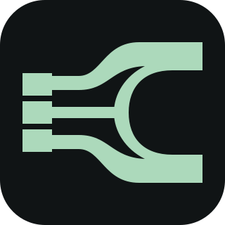

<p align="center">
  <a href="https://castlink.ru"></a>
</p>

<h1 align="center">CastLink</h1>
<p align="center"><strong>CastLink 1.0.0-rc.8</strong></p>
<p align="center"><strong>Удалённые кастеры. Отдельные источники. Ваш эфир.</strong></p>
<p align="center">Подключение через браузер · OBS и vMix · Свой сервер</p>
<p align="center">
  <a href="https://github.com/resokol/castlink/releases/download/client-v1.0.0-rc.8-f6c47a27a62c/CastLink-Client-1.0.0-rc.8-f6c47a27a62c-setup.exe"><strong>Windows Client</strong></a> · <a href="https://github.com/resokol/castlink/releases/download/server-setup-v1.0.0-rc.8-d703726cd50b/CastLink-Windows.zip"><strong>Windows Server</strong></a> · <a href="https://github.com/resokol/castlink/releases/download/linux-v1.0.0-rc.8-d703726cd50b/CastLink-Linux.tar.gz"><strong>Linux Ubuntu</strong></a>
</p>
<p align="center">
  <a href="https://castlink.ru">Сайт</a> &nbsp; / &nbsp;
  <a href="distribution/INSTALL.md">Инструкция</a> &nbsp; / &nbsp;
  <a href="CHANGELOG.md">Что нового</a> &nbsp; / &nbsp;
  <a href="https://t.me/sklvmax">Связаться с автором</a> &nbsp; / &nbsp;
  <a href="https://t.me/sklvmax"><strong>♡ Поддержать CastLink</strong></a>
</p>

<p align="center">Открытый исходный код под <a href="LICENSE">MIT</a> · <a href="distribution/PRODUCTS.md">Все пакеты и контрольные суммы</a></p>

---

CastLink — студия для удалённого подключения кастеров, презентаций и передачи отдельных аудио- и видеопотоков в OBS/vMix. Студия и кастеры работают в браузере; для Windows доступен отдельный клиент. Репозиторий содержит исходники приложения, инструменты сборки и документацию для разработчиков.

## Скачать и установить

Готовые пакеты и контрольные суммы: [каталог продуктов](distribution/PRODUCTS.md), [выпуски основного репозитория](https://github.com/resokol/castlink/releases). Windows Client, Windows Server Setup и standalone Linux имеют независимые версии; пакет и `SHA256SUMS` нужно брать из одного выпуска одного продукта.

| Продукт | Назначение |
| --- | --- |
| Windows Client | Приложение кастера и студии. Устанавливается через `setup.exe`; Docker не нужен. |
| Windows Server Setup | Мастер установки сервера на Windows или на Linux Ubuntu по SSH. Распакуйте весь `CastLink-Windows.zip` и запустите `EasySetup.exe`. |
| Linux Ubuntu | Самостоятельная установка сервера: [Linux manual](distribution/LINUX_MANUAL.md), быстрый и расширенный режимы. |

[Установка: Русский / English / 简体中文](distribution/INSTALL.md) · [Руководство пользователя](distribution/README.md) · [Управление ПК](docs/REMOTE_PC_CONTROL_RU.md).

Единственный публичный репозиторий CastLink — [resokol/castlink](https://github.com/resokol/castlink): собственные исходники по MIT, выпуски и инструкции. Архивы и `SHA256SUMS` доступны без предоставления отдельного доступа. Прежнее имя `resokol/castlink-releases` перенаправляет сюда и сохраняется для совместимости старых ссылок и установщиков; это не отдельное зеркало. Общий `releases/latest` не определяет сразу три продукта.

Существующие архивы и их SHA256 сохранены без пересборки. Встроенные manifests и старые проверки обновлений могут содержать прежнее имя `castlink-releases`: GitHub перенаправляет этот адрес в тот же `castlink`. Для ручной установки выбирайте точный выпуск из каталога.

Для Windows-сервера нужен Docker Desktop с Linux-контейнерами; VPS-установка поддерживает Ubuntu 22.04/24.04 amd64. Самостоятельная установка работает на инфраструктуре её владельца. Условия сети, HTTPS, порты и обновление описаны в руководствах.

## Разработка

Нужны Git, Node.js 22 и pnpm 9.15.0. Версии зависимостей закреплены в `pnpm-lock.yaml`.

```sh
git clone https://github.com/resokol/castlink.git
cd castlink
pnpm install --frozen-lockfile
pnpm typecheck
pnpm test:ci
pnpm build
```

Для запуска интерфейса используйте `pnpm dev`. Полноценный локальный стенд требует LiveKit, конфигурацию доступа и выбранное хранилище; создавайте отдельную среду и данные для разработки. Шаблоны конфигурации находятся в `infrastructure/`. Не используйте данные работающего сервера для тестов.

| Каталог | Содержимое |
| --- | --- |
| [apps/web](apps/web) | Next.js/React, серверные API и браузерные интерфейсы |
| [apps/desktop](apps/desktop) | Windows-клиент и нативные интеграции |
| [apps/cli](apps/cli) | Исследовательский CLI; отличается от установщика standalone Linux |
| [native](native) | Нативные компоненты Windows и протоколы |
| [scripts](scripts) | Сборка, установщики, миграции и проверки |
| [infrastructure](infrastructure) | Compose, SQL, шаблоны сервисов и runtime-компоненты |
| [docs](docs/README.md) | Архитектура, разработка и эксплуатация |
| [distribution](distribution) | Пользовательские инструкции и описание направлений выпуска |

Начните с [учебного мануала](docs/MANUAL_RU.md), [карты проекта](docs/PROJECT_GUIDE_RU.md) и [технических инвариантов](docs/CRITICAL_INVARIANTS_RU.md). Для интерфейса используйте [дизайн-систему](DESIGN.md) и [карту UI](docs/UI_EDITING_GUIDE_RU.md). Изменение исходников само по себе не обновляет установленное приложение или сервер.

## Участие в проекте

Порядок изменений и проверок описан в [CONTRIBUTING](CONTRIBUTING.md). Об уязвимостях сообщайте по [SECURITY](SECURITY.md).

## Лицензия

Собственный исходный код CastLink распространяется по [MIT](LICENSE): разрешены использование, изменение и распространение с сохранением copyright и текста разрешения. Сторонние компоненты сохраняют свои лицензии и права: [THIRD_PARTY_NOTICES](THIRD_PARTY_NOTICES).

Уже выпущенные пакеты Client `f6c47a27a62c` и Server Setup/Linux `d703726cd50b` сохраняют вложенную CastLink Freeware Distribution License 1.1. Их архивы и SHA256 не меняются; текущая MIT-лицензия исходников не заменяет лицензию внутри этих пакетов.

Автор: [Telegram @sklvmax](https://t.me/sklvmax), [GitHub resokol](https://github.com/resokol).
